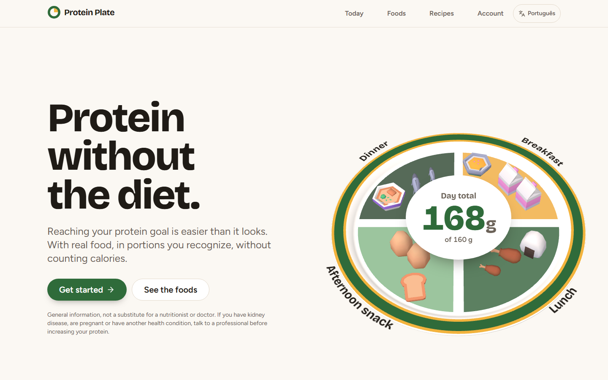
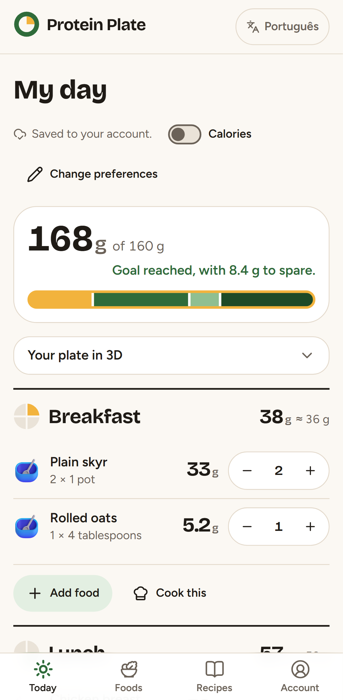
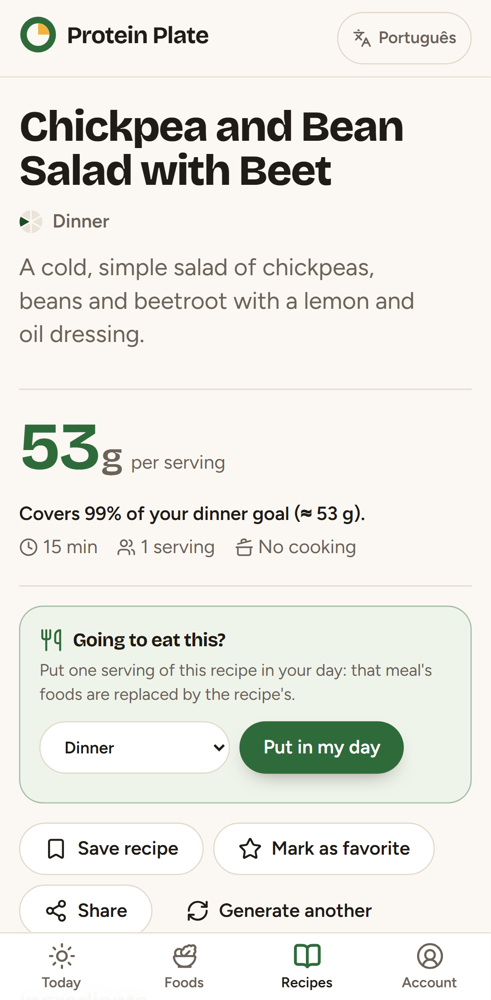
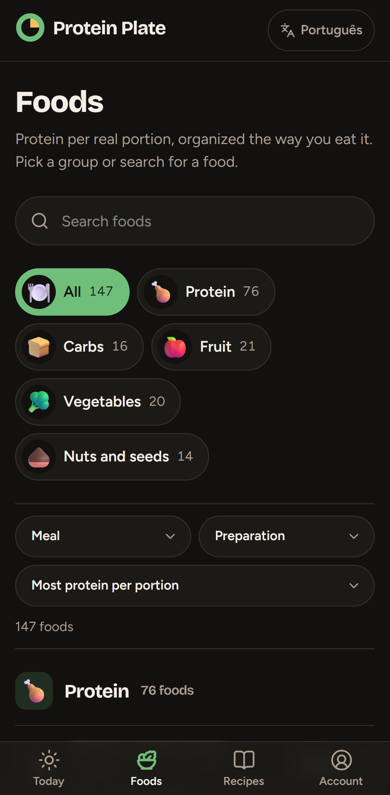

# Protein Plate

**Protein without the diet.** A web app that shows hitting your daily protein goal is easy with real food. Sign in with Google or Apple, answer a two-minute welcome form (goal, meals and training, what you don't eat, what you like, your kitchen), and you get a full day built from your own foods that already reaches the goal. Adjust real portions, then generate AI recipes made for you. No diet, no calorie counting.

**Live:** [protein-plate.app](https://protein-plate.app) (English at [/en](https://protein-plate.app/en)) · **Case study:** [docs/case-study.en.md](docs/case-study.en.md) · [Versão em português](README.pt.md)



| My day                                                                                                            | AI recipe                                                                                                     | Dark mode                                                                             |
| ----------------------------------------------------------------------------------------------------------------- | ------------------------------------------------------------------------------------------------------------- | ------------------------------------------------------------------------------------- |
|  |  |  |

## What it does

- **Welcome form** in 6 steps: goal (weight × training intensity, or a manual goal), meals with pre- and post-workout, diet and allergies, foods you like, cooking time and equipment. Weight and allergies are stored only with explicit health-data consent.
- **A day that already works**: a deterministic example day built only from what you can eat, your favorites first. Property-based tests check every goal from 80 to 250 g across all 57 meal combinations: the total always lands between 100% and 110%.
- **Realistic meal goals**: lunch and dinner carry more protein than breakfast, and snacks the least (weights 3/2/1; a post-workout meal gets at least 2). Light meals never get a dinner protein like chicken.
- **Adjust the day**: half-portion steppers, an add-food drawer, "23 g to go" in an `aria-live` region and three one-tap suggestions to hit the goal.
- **AI recipes** (`POST /api/recipes`): closed fields only; the meal goal, training, equipment and diet come from the profile; foods with allergens never reach the model; rate limiting and daily per-account quotas; cache, then a library of pre-generated recipes re-fitted to your portions, then the model; post-model validation with one retry. **Protein is always computed by the app**, never by the model.
- **Whole-day recipes**: one recipe per meal, in parallel, then "Put the whole day in My day".
- **Food catalog**: 168 foods as static pages, grouped like the welcome form, with protein per portion front and center and an optional "most protein per calorie" sort.
- **"Food Wheel" design**: the day is a wheel that fills up, each meal a slice, like the food wheel from Portuguese schools. The home page is a story where scrolling turns the wheel. A **3D plate** (three + React Three Fiber) fills up with the day's foods on desktop, loaded only after the LCP.
- **Accounts**: Google and Apple via Better Auth, versioned consent, data export (JSON) and account deletion with recent login.
- **Back office** (`admin/`, a separate Worker behind Cloudflare Access): dashboard, users, recipes and foods, never health data per person.

## Stack

- **Next.js 16** (App Router, strict TypeScript) on **Cloudflare Workers** with `@opennextjs/cloudflare`
- **Cloudflare D1** (EU) + **Drizzle ORM**, Cloudflare rate limiting, hourly cron
- **Better Auth 1.7**, **AI SDK 6** + Anthropic (`claude-haiku-5-5`)
- **Tailwind v4**, Radix, Lucide, **motion**, `next-intl` (Portuguese without a prefix, English at `/en`)
- **three** + **@react-three/fiber** (no drei), Kenney Food Kit models (CC0) optimized with `@gltf-transform/cli`
- **Zod 4**, **Vitest** + fast-check, **Playwright** + axe-core, Lighthouse CI

## Architecture

```text
src/domain/      pure rules: goal, meals, protein, example day, suggestions, recipe base, Zod contracts
src/server/      D1, Better Auth, AI, services and Server Actions (server-only, injected db)
src/features/    UI per feature: onboarding, catalog, day, recipes, account, landing, plate-3d
src/components/  ProteinNumber, GoalProgress, MealSection, PortionStepper, Wheel, chips…
content/foods/   single source of truth for foods → D1 seed + typed module
worker/          custom Worker: validates env (won't start without valid secrets), headers, cron
admin/           back office (own Worker, Cloudflare Access, server-rendered HTML, no JavaScript)
```

Decisions worth knowing:

- **The model never does the math.** The recipe schema is fixed; the app checks every ingredient against the catalog, re-fits the protein sources to the target and computes protein and calories from `content/foods`.
- **Locales without middleware.** The Next 16 proxy runs on Node, which is still experimental on Workers, so routes are rewritten to `/pt/...` in `next.config.ts`; English uses the same paths under `/en`.
- **Sign-in required, instant day.** App pages need a session and a finished welcome form. The day lives only in D1: the screen updates at once and each change is saved by a Server Action (debounced, one request at a time, always the latest day); the server filters everything again by the person's meals and restrictions.
- **Health data only with consent**: weight and allergies are never sent to the AI and never shown per person in the back office.
- **No PII in logs**: quotas use an HMAC with a daily key; sessions store no IP or user agent; OAuth tokens are discarded (except Apple's refresh token, encrypted, to revoke access on account deletion).

## Quality

|                                                           |                                                                                                                                                                                              |
| --------------------------------------------------------- | -------------------------------------------------------------------------------------------------------------------------------------------------------------------------------------------- |
| Lighthouse mobile (production, median of 5 runs)          | performance 90–92, accessibility 100, best practices 100, SEO 100 on indexable pages; TBT 40 ms, CLS 0                                                                                       |
| Recipe evals (`eval:recipes`, 27 fixed cases, real model) | 27/27 valid on the first try; p50 2.5 s, p95 3.2 s                                                                                                                                           |
| Tests                                                     | unit and property-based tests for `src/domain`, integration tests on a real local D1 with two users per action, Playwright end-to-end on mobile and desktop, axe-core in light and dark mode |
| CI                                                        | format, lint, types, content checks, unit and integration tests, OpenNext build, e2e, then deploy to staging; production is a manual workflow that refuses commits without a green CI        |

## Run locally

Requires Node 24.

```bash
npm ci
cp .dev.vars.example .dev.vars   # fill in BETTER_AUTH_SECRET and IP_HASH_SECRET (32+ characters)
npm run db:migrate:local
npm run db:seed:local
npm run dev                      # http://localhost:3000 (mocked AI)
npx tsx --env-file=.dev.vars scripts/dev-session.ts   # local test session (pp.session_token cookie)
npm run preview                  # OpenNext build + local Worker, same as production (:8787)
```

```bash
npm run lint && npm run typecheck && npm test   # unit + integration on the local D1
npm run test:e2e                                 # Playwright
npm run eval:recipes                             # against the real model (ANTHROPIC_API_KEY)
```

The project specification (in Portuguese) is in [`docs/especificacao.md`](docs/especificacao.md).
